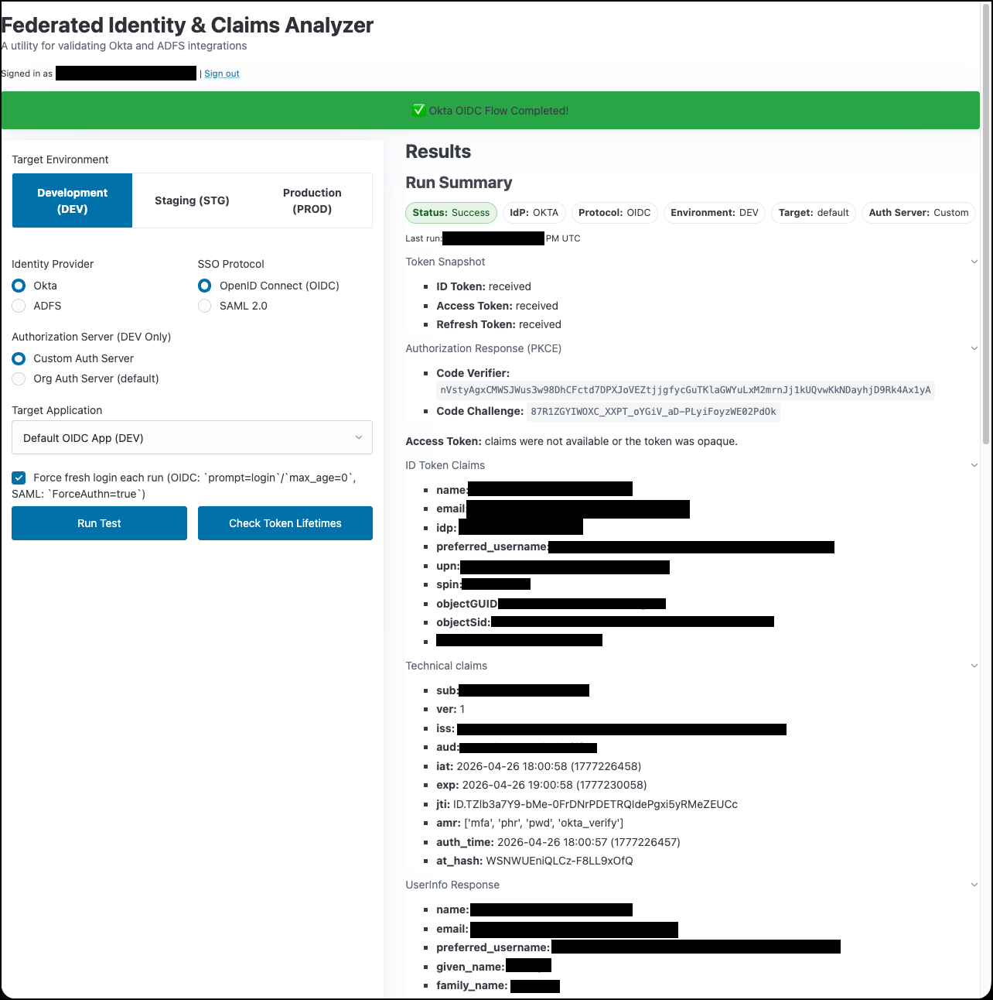

> **When an SSO flow is misbehaving, this is what I reach for to get ground
> truth — every claim, every attribute, every token, the signed and decoded
> JWTs, the full SAML assertion — from a real sign-in against the real IdP.**

# Federated Identity & Claims Analyzer

An interactive SSO tester for Okta and ADFS. Pick an identity provider and a
protocol (OIDC or SAML 2.0), the tool runs the full sign-in against your
account, and shows you exactly what came back.



---

### About this repo

This is a sanitized snapshot of an internal tool, published through an
automated review-and-publish pipeline. Internal identifiers — hostnames,
tenant names, resource names, certificates, Okta object IDs — are replaced
with placeholders (`example.invalid` hosts, a throwaway
self-signed certificate, `0oaEXAMPLE00EXAMPLE0`). The code is the code that
runs; the configuration values are not. Replace them with your own.

---

## What it does

- Runs a **real, end-to-end sign-in** against any number of Okta and ADFS
  environments (you name them in settings) using **OIDC** (authorization code +
  PKCE) or **SAML 2.0** (SP-initiated).
- Decodes and displays every claim and attribute, separated into *implicit*
  (protocol) and *detailed* (custom) sets, plus the raw tokens and the raw
  SAML assertion.
- **Token Lifetime Check** — queries an Okta authorization server's policy
  rules for access/refresh token lifetimes without running a sign-in.
- **Refresh** — exercises the refresh-token grant against the IdP and shows
  the new tokens.
- **Force fresh login** — runs the flow with `prompt=login` so a cached IdP
  session can't mask what a cold sign-in returns.

## What it doesn't do

- It doesn't create or modify users, and it doesn't change IdP configuration.
- It isn't a load tester — single interactive flow.
- It isn't a substitute for the IdP's own logs when you need to know what a
  *user* experienced; it tells you what *you* see when you reproduce.

## How validation works

| Path | What is verified |
|---|---|
| Okta / ADFS **ID token** | Signature against the IdP's JWKS (`RS256` only), `aud`, `iss`, `exp` — via `authlib.jose` |
| Okta **access token** | Same, when the token is a JWT (custom authorization servers) |
| **SAML response** | Signature, `strict` mode, `wantAssertionsSigned`, SHA-256 — via `python3-saml` |
| ADFS **access token** | **Decoded without verification.** ADFS access tokens are opaque to the SP by design; the claims are shown for inspection only and are *not* trustworthy. This is labeled in the code (`verify_signature=False`). |

## Project layout

| File | Role |
|---|---|
| `app.py` | Flask app — auth gate, test runner, callbacks, refresh, lifetime check |
| `sso_tester_logic.py` | OIDC discovery, PKCE, JWKS validation, SAML processing, TLC |
| `saml_settings.py` | Builds the `python3-saml` settings for one configured SAML IdP |
| `idp_config.py` | Builds the Okta, ADFS and SAML IdP lists from environment settings |
| `index.html`, `login.html` | Templates (served from the app directory) |
| `HOWTO.md` | In-app help, rendered at `/howto` |
| `guards.py` | Startup settings check, allow-list, redirect validation, OAuth state compare, safe error text |
| `http_session.py`, `howto_page.py` | HTTP session factory; `/howto` page |
| `tests/` | pytest suite (no network) |
| `smoke_test.py` | Pre-deploy static checks and post-deploy reachability checks |
| `Dockerfile`, `docker-compose.yml` | Container image (gunicorn, 2 workers × 4 threads) and `docker compose up` |

## Routes

| Route | Purpose |
|---|---|
| `/` | Test form and results |
| `/run_test` `POST` | Start a flow for the chosen IdP + protocol |
| `/okta/oidc/callback`, `/adfs/oidc/callback` | OIDC redirect URIs |
| `/okta/saml/callback`, `/adfs/saml/callback` `POST` | SAML assertion consumer URLs |
| `/check_token_lifetimes` `POST` | Token Lifetime Check |
| `/refresh_token` `POST` | Refresh-token grant |
| `/login`, `/oidc/login`, `/oidc/callback`, `/logout` | The tool's own sign-in gate (Okta OIDC) |
| `/howto` | In-app help |
| `/health` | Liveness |

## Access to the tool itself

The app is gated by its own **OIDC** client (authorization code + PKCE,
`state` and `nonce` validated by Authlib). Signing in at the issuer is not
enough: the user must also be on the in-app allow-list, by email
(`ALLOWED_EMAILS`) or by group (`ALLOWED_GROUPS`, read from the
`OIDC_GROUPS_CLAIM` claim; you may need to add the groups scope to
`OIDC_SCOPES`). Anyone else is refused at `/oidc/callback`.

Set `OIDC_ISSUER`, `OIDC_CLIENT_ID`, `OIDC_CLIENT_SECRET`, `APP_BASE_URL` and
at least one of `ALLOWED_EMAILS` / `ALLOWED_GROUPS`. **The app refuses to
start without them** (and without `FLASK_SECRET_KEY`), naming what is missing,
unless you set `AUTH_MODE=none` explicitly. `AUTH_MODE=none` serves every
route without a login; use it for local development only.

Every `POST` route except the two SAML callbacks needs the session's CSRF
token (a form field or an `X-CSRF-Token` header). The SAML callbacks are
posted by the IdP, so they are protected by the SAML signature check instead.
Errors shown to a browser are fixed messages; the detail goes to the log. The
IdP's own error text (status and a bounded body) is shown to signed-in users
only.

## Configuration

**Type:** web service (Flask, served by gunicorn). Everything is an
environment variable; `.env.example` lists them all (with the per-name
settings below spelled out), and `docker-compose.yml` passes that same `.env`
file through. Locally the app also reads `env.config` if present (never
committed). A required setting has no default: the app stops at startup and
names it.

| Variable | Required | Default | Purpose |
|---|---|---|---|
| `APP_BASE_URL` | yes | none | Public URL users open, no trailing slash; builds redirect URIs. `https` gives a `SameSite=None; Secure` session cookie; `http` gives `SameSite=Lax` (SAML sign-in then needs `https`) |
| `FLASK_SECRET_KEY` | yes | none | Session signing — must be identical across workers |
| `PORT` | no | `8080` | Port the server listens on |
| `AUTH_MODE` | no | `oidc` | `oidc` or `none` (no login; local development only) |
| `OIDC_ISSUER`, `OIDC_CLIENT_ID`, `OIDC_CLIENT_SECRET` | when `AUTH_MODE=oidc` | none | The tool's own sign-in |
| `ALLOWED_EMAILS`, `ALLOWED_GROUPS` | one of them, when `AUTH_MODE=oidc` | none | Comma-separated allow-list |
| `OIDC_GROUPS_CLAIM` | no | `groups` | Claim holding the user's groups |
| `OIDC_SCOPES` | no | `openid email profile` | Scopes requested at sign-in |
| `OKTA_ENVIRONMENTS` | one of Okta/ADFS | none | Comma-separated environment names, any number |
| `OKTA_<N>_ISSUER`, `OKTA_<N>_CLIENT_ID`, `OKTA_<N>_OIDC_SECRET` | per name | none | The tester's OIDC app in environment `<N>` |
| `OKTA_<N>_AUDIENCE`, `OKTA_<N>_DEFAULT_ISSUER`, `OKTA_<N>_DEFAULT_AUDIENCE` | no | client id; none; `api://default` | Access-token audience; optional "default" authorization server |
| `OKTA_<N>_API_TOKEN` | for the lifetime check | none | Read-only API token for the Token Lifetime Check |
| `ADFS_ENVIRONMENTS` | one of Okta/ADFS | none | Comma-separated environment names, any number |
| `ADFS_<N>_ISSUER`, `ADFS_<N>_CLIENT_ID`, `ADFS_<N>_CLIENT_SECRET` | per name | none | The tester's OIDC client in environment `<N>` |
| `SAML_IDPS` | no | none | Comma-separated keys `OKTA_<target>` / `ADFS_<target>` |
| `SAML_SP_ENTITY_ID` | when `SAML_IDPS` is set | none | This tool's SAML entity id |
| `SAML_<K>_ENTITY_ID`, `_SSO_URL`, `_CERT`, `_ENV` | per key | none | IdP entity id, SSO URL, signing certificate (PEM, `\n` for newlines), and the environment it appears under |
| `SAML_<K>_LABEL`, `_SP_ENTITY_ID`, `_SP_CERT_FILE`, `_SP_KEY_FILE` | no | `SAML app <target>`; `SAML_SP_ENTITY_ID`; `saml_tester.cert`; `saml_tester.key` | Form label and per-IdP SP overrides |
| `SAML_TESTER_CERT`, `SAML_TESTER_KEY` | cloud only | none | SAML signing key pair as PEM text |
| `FORCE_FRESH_LOGIN_DEFAULT` | no | `true` | Ask the IdP for a fresh login |
| `K_SERVICE`, `KUBERNETES_SERVICE_HOST`, `CONTAINER_APP_NAME` | set by the platform | none | When present: HSTS header, log format without timestamps, SAML key pair read from `SAML_TESTER_CERT`/`SAML_TESTER_KEY` (the first two) |
| `SMOKE_TLS_VERIFY` | no | `true` | `smoke_test.py` only; `false` skips TLS verification |

Example: `OKTA_ENVIRONMENTS=DEV,STG` with `OKTA_DEV_ISSUER`, `OKTA_DEV_CLIENT_ID`,
`OKTA_DEV_OIDC_SECRET` and the same three for `STG`. The Token Lifetime Check
calls the Okta org at the scheme and host of the issuer. The SP signing key
pair (`saml_tester.cert` / `saml_tester.key`) sits next to the app and is not
committed.

## Running it

```bash
cp .env.example .env    # fill in values, including APP_BASE_URL
docker compose up       # serves on PORT (default 8080)
```

Without Docker: `pip install -e .`, copy `.env.example` to `env.config`, then
`python app.py` (HTTPS on `PORT`, using the SP keypair as the dev cert).
Tests: `pip install -e ".[dev]"` then `pytest` (no network needed).

`smoke_test.py` runs static checks before a build, and with
`--post-deploy <url>` reachability checks after.

## Known limitations

- **Tokens live in the session cookie.** Raw ID/access/refresh tokens and the
  pretty-printed SAML response are stored in Flask's signed (not encrypted)
  cookie so results survive the redirect. Large SAML responses can push the
  cookie past the ~4 KB browser limit, which drops the session. Moving to a
  server-side store is the fix.
- **Validation failures render as "no token."** When a signature or `aud` /
  `iss` check fails, the claims panel shows "ID Token was not provided by the
  IdP" rather than the specific validation error. The error is logged, not
  surfaced.
- Every name you list in `OKTA_ENVIRONMENTS` / `ADFS_ENVIRONMENTS` needs all its
  settings, or the app does not start.
- SAML sign-in needs an `https` `APP_BASE_URL` (see the cookie note above).
- The SAML SP certificate loader and `saml_settings.py` read different paths
  on cloud hosts.
- Tests cover the auth gate, redirects, state checks, IdP error paths, token
  validation and SAML response processing (with a fake `python3-saml` object,
  not a real signed assertion).
- Discovered OIDC endpoints are cached per worker, keyed by issuer. A worker
  that has not seen an issuer discovers it on the first request.

## Version

`APP_VERSION` in `sso_tester_logic.py` is authoritative (currently 7.3.x).

## License

MIT — see [LICENSE](LICENSE).

## Author

Wes Glockzin
